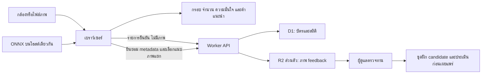

# AI WasteVision

เว็บแอปภาษาไทยสำหรับศึกษาการคัดแยกขยะจากภาพ ออกแบบให้ใช้งานและนำเสนอบนมือถือเป็นหลักในแนว Italian luxury รองรับหน้าคอมพิวเตอร์ด้วย โมเดลประมวลผลบนอุปกรณ์และมีบัตรสะสมแต้มแบบหมายเลขโทรศัพท์

- **ลิงก์หลัก:** [AI WasteVision](https://ai-wastevision-th.tenderheron1024.chatgpt.site)
- **หน้านำเสนอ:** [ภาพรวมระบบ](https://ai-wastevision-th.tenderheron1024.chatgpt.site/presentation.html)
- **โค้ดหลัก:** [TomatosHanWhann/AI-WasteVision](https://github.com/TomatosHanWhann/AI-WasteVision)

เอกสารนี้เป็นจุดเริ่มต้นสำหรับผู้รับช่วงงาน ไม่จำเป็นต้องมีประวัติแชต โค้ด โมเดล รายงานผล และคู่มือพัฒนาอยู่ใน repository ส่วน secret และข้อมูลผู้ใช้ไม่อยู่ใน Git

## สถานะที่ต้องทราบก่อนนำเสนอ

ระบบเผยแพร่เป็น **รุ่นทดลอง** ความมั่นใจ 0–100 ไม่ใช่ความแม่นยำจริงของภาพนั้น โมเดลหลายชิ้นยังตกหล่นมาก โดยเฉพาะขยะเล็ก กองทับกัน และกลุ่มที่ข้อมูลน้อย ห้ามใช้การตรวจไม่พบเป็นหลักฐานว่าไม่มีแบตเตอรี่หรือสิ่งอันตราย และยังไม่มีผลประเมินวัตถุใช้แล้วในบริบทไทยแบบแยกตามวัตถุจริง

รอบดีไซน์นี้ไม่ได้ฝึกหรือปรับเกณฑ์โมเดลเพื่อทำให้ตัวเลขดูดีขึ้น ดู [ผลตรวจตามลำดับผู้ใช้](docs/USER_JOURNEY_QA.md) สำหรับสิ่งที่ทดสอบผ่านจริงและส่วนที่เครื่องมือยังตรวจไม่ได้ ไม่ควรกล่าวว่าทดสอบกล้องมือถือหรือทุกฟังก์ชันผ่าน end-to-end แล้ว

## วิธีใช้สำหรับผู้ทดลอง

1. เปิดลิงก์หลัก อ่านภาพรวมและวิธีใช้ แล้วเลือก **จำแนกขยะ** จากเมนูด้านล่างบนมือถือ หรือเมนูด้านบนบนคอม
2. เลือกโหมดหลายชิ้น วางขยะแยกกัน 1–10 ชิ้น ให้เห็นครบ ใช้กล้องหรือเลือก JPG/PNG/WebP ไม่เกิน 15 MB ภาพเกิน 40 ล้านพิกเซลถูกปฏิเสธ HEIC/HEIF ต้องแปลงก่อน
3. รอโมเดลพร้อม กด **วิเคราะห์ภาพ** ตรวจกรอบหมายเลข จำนวนที่ตรวจพบ และความมั่นใจรายชิ้น ค่าเฉลี่ยต่อรอบครอบคลุมเฉพาะรายการที่ตรวจพบ
4. เลือกรูปแบบถังของสถานที่และสภาพรายชิ้น อ่านชื่อจุดทิ้งควบคู่สีถัง ตรวจป้ายและเงื่อนไขของจุดรับจริง แบตเตอรี่ อิเล็กทรอนิกส์ หลอดไฟ ภาชนะมีแรงดัน และแก้วแตกมีคำแนะนำแยกเฉพาะ
5. หากต้องการสะสมแต้ม เปิดบัตรด้วยเบอร์มือถือไทยของท่านและยินยอมใช้เบอร์ จากนั้นยืนยันรายการที่เข้าเงื่อนไขทีละชิ้น
6. หากต้องการช่วยประเมิน เปิด **ร่วมประเมินผลการวิเคราะห์** ตรวจคำตอบ/จำนวนจริงและให้ความยินยอมส่งข้อมูล การแนบภาพมีความยินยอมแยกต่างหาก ส่วนนี้ไม่เพิ่มแต้ม
7. ใช้ปุ่มแชร์ที่หัวเว็บเพื่อแสดง QR หรือคัดลอกลิงก์หลักให้ผู้อื่น ภาพตัวอย่างไม่เพิ่มแต้มและไม่เข้าสถิติผู้ใช้

## หน้าจอและโหมดการใช้งาน

| หน้า/เส้นทาง | หน้าที่ |
| --- | --- |
| `/` หรือ `#about` | ภาพรวม วัสดุพื้นฐาน ข้อจำกัด และผลประเมินที่วัดจริง |
| `#guide` | ขั้นตอนใช้ระบบและเงื่อนไขบัตร |
| `#scan` | ถ่าย/เลือกภาพ ตรวจจับหลายชิ้น หรือเลือกโมเดลวัสดุพื้นฐานหนึ่งชิ้น |
| `#card` | เปิดบัตร ตรวจยอด ประวัติล่าสุด ปิดบัตร และดูบัตร A ตัวอย่างที่ระบุว่าเป็นข้อมูลสาธิต |
| `/presentation.html` | HTML entry สำหรับนำเสนอ ใช้แอปและข้อมูลระบบชุดเดียวกัน |

มือถือมีเมนูคงที่ด้านล่างและรองรับ safe area ปุ่มถ่าย/เลือกภาพอยู่เหนือภาพ หน้าคอมใช้ภาพและผลลัพธ์คู่กัน ฟอนต์ทั้งหมดอยู่บนโฮสต์เดียวกัน ไม่มีการเรียก Google Fonts ขณะใช้งาน มี manifest สำหรับการเปิดเป็น web app ตามความสามารถของเบราว์เซอร์ แต่ยังไม่รับรองการติดตั้งบนอุปกรณ์จริงและ **ไม่มีโหมด offline**

[ภาพมือถือ](docs/screenshots/mobile-home.jpg) · [ภาพเดสก์ท็อป](docs/screenshots/desktop-home.jpg) · [ระบบออกแบบ](DESIGN.md)

## โมเดลและข้อมูล

| โมเดล | งาน | หลักฐาน |
| --- | --- | --- |
| `realwaste-thai-mobilenetv2-v2` | จำแนกภาพวัตถุหลัก: พลาสติก โลหะ กระดาษ กระดาษแข็ง เศษอาหาร แก้ว และ unknown | Known test 532 ภาพ: accuracy 82.14% ก่อนปฏิเสธ, macro F1 0.8423; Thai-product known holdout เพียง4ภาพ ถูก1ภาพ |
| `wastevision-ssdlite-v3` | ตรวจตำแหน่งและนับรายชิ้น 15 กลุ่ม รวม unknown; แสดงสูงสุด10ชิ้น | Test548ภาพ / วัตถุ960ชิ้น: Precision60.43%, Recall28.96%, mAP50–95 21.16%, นับตรงทั้งภาพ57.12%, count MAE1.0584ชิ้น |

ตัวเลขสองโมเดลเป็นคนละงาน ห้ามใช้ accuracy ของตัวจำแนกภาพแทนประสิทธิภาพการตรวจจับหลายชิ้น

ข้อมูลตรวจจับใช้ภาพได้3,652ภาพ / วัตถุ6,941ชิ้น / source groups2,654กลุ่ม จาก TACO และ Custom Bangladeshi E-Waste มี augmentation ที่ผู้เผยแพร่จัดไว้ จึงไม่ใช่3,652วัตถุจริงที่เป็นอิสระ แบ่ง train/validation/test เป็น2,541/563/548ภาพ ตรวจ source filename และ SHA256 ข้ามชุดแล้ว แต่ยังไม่ยืนยัน physical-item holdout

กลุ่มตัวตรวจจับ: พลาสติก โลหะ กระดาษ กระดาษแข็ง เศษอาหาร แก้ว ถุง/ฟิล์ม บรรจุภัณฑ์หลายชั้น โฟม แบตเตอรี่ อิเล็กทรอนิกส์ หลอดไฟ ภาชนะมีแรงดัน แก้วแตก และ unknown แบตเตอรี่มี test recall50% จาก24วัตถุ ส่วนภาชนะมีแรงดัน/แก้วแตกมี recall0 จากกลุ่มละ2วัตถุ ผลหลอดไฟ100%มาจากเพียง6วัตถุ ไม่ใช่การรับรองทั่วไป

มีภาพแบรนด์ที่พบในไทย23ภาพจาก9แบรนด์และตัวอย่างวัสดุ พร้อมแหล่งที่มา ไม่ใช่ระบบระบุยี่ห้อ ภาพผลิตภัณฑ์ไม่ทดแทนภาพบรรจุภัณฑ์ใช้แล้วจริง

- [Detection model card](docs/DETECTION_MODEL_CARD.md) และ [โมเดลวัสดุพื้นฐาน](docs/MODEL_CARD.md)
- ผลวัดจริง: `ml/results/detection-evaluation.json`, `detection-predictions.csv`, `detection-manifest.csv`
- โมเดลที่เว็บใช้: `public/model/` พร้อม metadata และ SHA256 ตรวจด้วย CI
- MobileNetV2 ใช้ภาพเต็มรักษาสัดส่วน เติมพื้นขาว224×224; SSDLite ใช้ RGB320×320แบบstretch ปรับค่าเป็น[-1,1], NMS.45, top150และสูงสุด10วัตถุ
- คะแนนตรวจจับปรับเทียบด้วย validation isotonic regression นิยามถูกคือประเภทตรงและIoU≥.50 ไม่รวมวัตถุที่ตกหล่น; ผลtest ECE.03982 / Brier.14266

## แต้มสะสมและข้อจำกัดตัวตน

1 รายการที่ยืนยัน = 1 ชิ้น = 1 แต้ม ครบ1,000ชิ้นแสดงระดับA จำกัด100รายการต่อวันตามวันUTC เซิร์ฟเวอร์นับเอง ไม่มีจำนวนแต้มที่ผู้ใช้ส่งไปเพิ่มโดยตรง ภาพ/วัตถุเดิมตามรหัสตรวจซ้ำในบัตรเดิมไม่เพิ่มซ้ำ ภาพตัวอย่าง ผลไม่แน่ใจ คะแนนต่ำกว่าเกณฑ์ และกลุ่มที่ต้องจัดการพิเศษไม่เพิ่มแต้ม

บัตรใช้หมายเลขมือถือไทย ไม่มีOTP/SMSหรือการยืนยันเจ้าของ ผู้ที่ทราบเบอร์อาจเรียกดูยอดได้ จึงไม่เหมาะกับรางวัลมีมูลค่าหรือข้อมูลส่วนตัวเพิ่มเติม ยอดเป็นการยืนยันของผู้ใช้ ไม่ใช่หลักฐานรับขยะจริงหรือระบบป้องกันการทุจริตสมบูรณ์ บัตรAตัวอย่างไม่เขียนฐานข้อมูล

เซิร์ฟเวอร์เก็บHMACของเบอร์และเลขท้าย4หลัก ไม่เก็บเบอร์เต็ม cookie sessionเป็นHttpOnly/SameSiteStrictและSecureบนHTTPS อายุ7วัน ปิดบัตรลบsessionบนอุปกรณ์ ไม่ลบแต้ม

## สถาปัตยกรรมและข้อมูลส่วนบุคคล



ไม่มีAPIวิเคราะห์ภาพที่มีค่าใช้จ่ายและไม่มีAPI keyในfrontend ภาพอยู่บนอุปกรณ์โดยปริยาย การสะสมแต้มส่งเฉพาะรายการและรหัสภาพ/วัตถุ ไม่ส่งภาพ การร่วมประเมินเป็นคนละความยินยอมกับบัตร และไม่ผูกกับเบอร์โทร

ภาพที่ยินยอมแนบถูกลดขนาดเป็นJPEGสูงสุด1,024pxและตัดEXIFผ่านcanvas ไม่ได้ลบใบหน้าหรือข้อมูลส่วนบุคคลในตัวภาพ จึงควรส่งเฉพาะภาพที่มีสิทธิ์และไม่มีข้อมูลส่วนตัว ภาพเก็บในR2ส่วนตัว ดูได้เฉพาะAPIผู้ดูแลที่มีsecret

ตารางD1: `members`, `card_sessions`, `sorting_events`, `request_limits`, `analysis_feedback` รายการประเมินเริ่มpending จากนั้นผู้ดูแลกำหนดreviewed/rejected ข้อมูลrejectedไม่เข้าสถิติสาธารณะ ข้อมูลผู้ใช้รายงานไม่ใช่ground truthที่ตรวจทานแล้ว และข้อมูลสมัครใจอาจมีอคติ

ผู้ใช้ลบรายการที่เก็บรหัสลบบนอุปกรณ์ได้ หากล้างข้อมูลเบราว์เซอร์รหัสจะหาย ไม่มีการลบfeedbackตามอายุอัตโนมัติในรุ่นนี้ ผู้ดูแลต้องมีนโยบายเก็บ/ลบและจัดการสำเนาที่ส่งออกเอง การลบในD1/R2ไม่ลบสำเนาฝึกที่เคยส่งออกหรือทำให้โมเดลที่ฝึกแล้วลืมข้อมูลโดยอัตโนมัติ

## เริ่มทำงานจาก Git

ต้องใช้Gitและ **Node.js22.13ขึ้นไป** ไม่ต้องมีPythonหรือฝึกโมเดลเพื่อแก้เว็บ

```sh
git clone https://github.com/TomatosHanWhann/AI-WasteVision.git
cd AI-WasteVision
npm ci
```

PowerShell:

```powershell
Copy-Item .dev.vars.example .dev.vars
npm run db:local
npm run dev
```

macOS/Linuxใช้ `cp .dev.vars.example .dev.vars` แทน เปิดURLที่terminalแสดง ปกติเป็นlocalhost5173หากพอร์ตว่าง ต้องใช้localhostหรือHTTPSเพื่อเปิดกล้อง ฐานข้อมูลและR2ท้องถิ่นอยู่ใน`.wrangler/` แยกจากproduction `.dev.vars`เป็นค่าเฉพาะเครื่อง ห้ามนำค่าตัวอย่างไปใช้production

```sh
npm test
npm run build
```

`npm run build` เตรียมONNX Runtime WASMและสร้าง`dist/client`กับ`dist/server` ไม่ควรส่งเฉพาะclientไปstatic host เพราะบัตรและfeedbackต้องมีWorker/D1/R2

## โครงสร้างที่แก้ต่อได้

| ตำแหน่ง | หน้าที่ |
| --- | --- |
| `src/views.js` | HTMLสาธารณะและเนื้อหาหลัก |
| `src/style.css` | ดีไซน์และbreakpointsมือถือ/คอม |
| `src/main.js` | กล้อง เลือกภาพ เส้นทาง สถานะโมเดล แชร์ และเชื่อมหน้าจอ |
| `src/card-controller.js` | จัดลำดับคำขอบัตร ป้องกันrefreshกับclose/openแข่งกัน |
| `src/inference.js`, `src/detection.js` | preprocessingและONNXบนเบราว์เซอร์ |
| `src/multi-ui.js`, `src/detection-domain.js` | ผลรายชิ้น สีถัง ข้อควรระวัง feedback |
| `src/loyalty.js` | API clientและบัตรสะสม |
| `worker/index.js`, `worker/feedback.js`, `worker/rules.js` | API/session/แต้ม/สถิติ/ตรวจทาน |
| `db/schema.js`, `drizzle/` | schemaและmigrationที่ต้องcommitพร้อมกัน |
| `public/model/`, `public/examples/`, `public/detection-examples/` | โมเดลและตัวอย่างที่เว็บใช้ |
| `ml/`, `ml/results/` | ดาวน์โหลด ฝึก ประเมิน และหลักฐานรายภาพ |
| `scripts/review-feedback.mjs` | เครื่องมือผู้ดูแลส่งออก/ส่งผลตรวจทาน |
| `tests/` | กฎสำคัญ APIจริงกับSQLite in-memory และการจัดลำดับคำขอบัตร |
| `DESIGN.md`, `docs/` | ระบบออกแบบ หลักฐาน และคู่มือส่งต่อ |

## API หลัก

POSTทั่วไปต้องsame-origin, JSONและheader `x-wastevision-client:web` มีขีดจำกัด40คำขอต่อนาทีต่อIPที่แปลงเป็นHMAC ไม่เก็บIPดิบ

| เส้นทาง | สิทธิ์/หน้าที่ |
| --- | --- |
| `POST /api/card` | เบอร์+consent เปิดหรือค้นหาบัตรและตั้งcookie |
| `GET /api/card` | cookieของบัตร ตรวจยอด |
| `POST /api/card/close` | ปิดsessionปัจจุบัน |
| `POST /api/scan-ticket` | cookie+รุ่นโมเดล/คะแนน/รหัสภาพที่เข้าเกณฑ์ สร้างticket10นาที |
| `POST /api/points` | ticket+condition+confirm เพิ่มหนึ่งรายการ |
| `GET /api/quality` | สถิติรวมแยกmodel_version ไม่เปิดภาพหรือข้อมูลสมาชิก |
| `POST /api/feedback` | consentข้อมูล และimageConsentหากแนบภาพ; ไม่ต้องเปิดบัตร |
| `POST /api/feedback/delete` | idและdeleteTokenของรายการ ลบข้อมูลและภาพ |
| `/api/review/export`, `/api/review/image`, `/api/review/decision` | ผู้ดูแลเท่านั้น ใช้Bearer REVIEW_ADMIN_SECRET ไม่มีหน้าadminสาธารณะ |

## Runtime และสิทธิ์ที่ต้องส่งต่อ

เว็บไซต์ใช้ **Sitesโครงการเดิม** `appgprj_6b015119326481919b8b1b0ddcd626a9` ใน`.openai/hosting.json` ผู้ชมpublic, D1 binding`DB`, R2 binding`BUCKET`

| ค่า | วิธีจัดการ |
| --- | --- |
| `PHONE_HASH_SECRET` | secretฝั่งproductionเท่านั้น อย่างน้อย32ตัวอักษร ห้ามเปลี่ยนโดยไม่มีแผนย้ายข้อมูล เพราะสมาชิกเดิมค้นไม่พบเมื่อHMACเปลี่ยน |
| `REVIEW_ADMIN_SECRET` | secretแยกสำหรับผู้ดูแล ไม่ใช่API keyให้ผู้ใช้และไม่ส่งเข้าfrontend |
| GitHub/Sites credentials | ไม่อยู่ในGit ต้องใช้บัญชีและสิทธิ์ของเจ้าของบริการ |

ผู้รับGitHubไม่ได้รับสิทธิ์Sitesหรือฐานข้อมูลโดยอัตโนมัติ เจ้าของต้องให้สิทธิ์editorในSitesหากต้องการให้เผยแพร่ได้ การเก็บsecretให้ใช้runtimeของบริการ ไม่ส่งsecretในแชต README URL หรือcommand history `.dev.vars`, `.wrangler`, `ml/data`, `ml/cache` และarchiveไม่เข้าGit

## การเผยแพร่และย้อนกลับ

**Push GitHubไม่ได้อัปเดตSitesอัตโนมัติ** GitHub Actionsตรวจโค้ด/build/modelเท่านั้น

1. pullงานล่าสุด สร้างbranchเฉพาะเรื่อง และรันtest/build
2. ผู้มีสิทธิ์Sitesเปิดsourceของprojectเดิม ห้ามสร้างSiteใหม่หรือเปลี่ยนaudienceโดยไม่ตั้งใจ
3. buildและpushsourceเดียวกันไปSites เก็บarchiveจาก`dist`ที่ตรงกับcommitนั้น ต้องมีhosting metadataและDrizzle migrations
4. save versionด้วยexact commit SHAและarchive แล้วdeploy saved versionผ่านSites
5. ตรวจลิงก์หลัก `/presentation.html`, metadata/hash, public APIและสิทธิ์private review แล้วpushcommitเดียวกันไปGitHub
6. หากต้องย้อนรุ่น ใช้saved versionที่ตรวจแล้ว คืนโค้ด โมเดล metadataที่ตรงกัน ไม่ลบฐานข้อมูลหรือแก้migrationที่applyแล้ว

ดูรายละเอียดใน [DEPLOYMENT.md](docs/DEPLOYMENT.md) ค่าdatabase_idในwrangler.jsonเป็นplaceholderท้องถิ่น อย่าใช้เป็นproduction ID หากย้ายผู้ให้บริการต้องจัดWorker/D1/R2และsecretใหม่อย่างถูกต้อง

## พัฒนาโมเดลต่อ

ใช้Python3.13และenvironmentตาม`ml/requirements.txt` การฝึกใช้CPUได้แต่ใช้เวลาและพื้นที่หลายGB ไม่ต้องทำเพื่อเปิดเว็บ

```sh
python -m venv .venv
# Windows
.venv/Scripts/python -m pip install -r ml/requirements.txt
.venv/Scripts/python ml/download_detection.py
.venv/Scripts/python ml/train_detector.py
.venv/Scripts/python ml/evaluate_detector.py
.venv/Scripts/python ml/check_model.py
```

macOS/Linuxใช้`.venv/bin/python` ดาวน์โหลด/ฝึกเฉพาะบนbranchทดลอง และcommitweights+metadata+รายงานร่วมกัน ภาพใหม่ต้องกำกับตำแหน่ง/ประเภทและแยกตามวัตถุจริงก่อนอ้างfield holdout อย่าปรับเกณฑ์จากภาพtestเพื่อให้demoดูถูกต้อง

การเรียนรู้ต่อเนื่อง: ผู้ใช้ยินยอม→pending→ผู้ดูแลตรวจภาพและแก้กรอบ/ประเภท→reviewed→ส่งออกเฉพาะreviewed→ฝึกcandidateรุ่นใหม่→วัดholdout→ตรวจเว็บ→เผยแพร่ ไม่มีการฝึกจากคำทำนายของตัวเองโดยอัตโนมัติ

```sh
# กำหนด REVIEW_ADMIN_SECRET ผ่านenvironmentที่เชื่อถือได้ก่อน ไม่ใส่ค่าจริงในคำสั่งหรือGit
node scripts/review-feedback.mjs export ml/data/review-queue
node scripts/review-feedback.mjs publish ml/data/review-queue/review-decisions.json
node scripts/review-feedback.mjs dataset ml/data/reviewed
python ml/train_detector.py --reviewed ml/data/reviewed/annotations.json --version wastevision-ssdlite-v4-candidate
```

คำสั่งpublishด้านบนส่งผลตรวจทาน ไม่ใช่deployเว็บ ต้องแก้และตรวจทุกคำตอบก่อนกำหนดreviewed อ่าน [CONTINUOUS_IMPROVEMENT.md](docs/CONTINUOUS_IMPROVEMENT.md)

## การทดสอบและงานที่ยังต้องเก็บ

- `npm test`:22กรณี รวมAPIกับSQLiteจริงในหน่วยความจำ, consent, session, แต้มซ้ำ,100ต่อวัน,999→1000ระดับA, special waste, private review, pending/reviewed/rejected และการจัดลำดับคำขอบัตร
- `npm run build`: ตรวจWorkerและสองHTML entry; build hookลบ`.dev.vars`ออกจากartifact
- `python ml/check_model.py`: hash, labels, shape, ONNXและmetadata/reportของทั้งสองโมเดล
- ตรวจChromeจริงรอบดีไซน์: หน้าแรก/คู่มือ/ตัวอย่างตรวจจับ/คำเตือนแบตเตอรี่/บัตร/QR/คัดลอกลิงก์ และviewport390×844กับ1440×1000
- เครื่องมือComputer Useหยุดระหว่างเตรียมทดสอบnative upload เพราะยืนยันURLหน้าต่างWindowsได้ไม่แน่นอน จึงยังไม่ยืนยันUI upload/camera/feedback/แต้มจากภาพของผู้ใช้แบบครบวงจรในรอบนี้ และไม่ได้ทดสอบซ้ำบนbrowserหลังแก้รายละเอียดท้ายรอบ
- ยังต้องตรวจAndroid/iPhoneจริง Safari การเพิ่มหน้าจอหลัก แสง/ฉากหลัง เวลาp95 ชุดวัตถุใช้แล้วในไทย และผู้ใช้ประมาณ10คน

รายละเอียดทุกขั้นและข้อจำกัดอยู่ใน [USER_JOURNEY_QA.md](docs/USER_JOURNEY_QA.md), [VERIFICATION.md](docs/VERIFICATION.md), [TESTING.md](docs/TESTING.md) รายการที่ยังตรวจไม่ได้ไม่ถูกนับว่าผ่าน

## ให้เพื่อนเข้าถึงและทำงานต่อ

Repositoryยังเป็นprivate การส่งลิงก์อย่างเดียวไม่ให้สิทธิ์อ่านโค้ด เจ้าของเปิดGitHub repository→Settings→Collaborators/Add people→เชิญบัญชีเพื่อน→ให้เพื่อนยอมรับคำเชิญ จากนั้นcloneและทำตามส่วนเริ่มต้นด้านบน ใช้branch/PRตาม [CONTRIBUTING.md](CONTRIBUTING.md) ไม่ใช้บัญชีหรือtokenร่วมกัน และไม่commitข้อมูลผู้ใช้

สำหรับผู้ทดลองทั่วไปส่งเพียงลิงก์หลักได้ ไม่ต้องมีGitHubหรือเปิดบัตรเพื่อวิเคราะห์ภาพ หากเพื่อนต้องpublishให้ให้สิทธิ์Sitesแยกต่างหากตามส่วนruntime ไม่ต้องเปลี่ยนrepositoryเป็นpublic

## แหล่งข้อมูลและสิทธิ์

RealWaste CC BY4.0; TACO release CC BY4.0; Custom Bangladeshi E-Waste CC BY4.0; ภาพOpen Food Facts contributors CC BY-SA3.0 มีเครดิตและURLรายภาพในcatalogและ`public/licenses/` การกล่าวถึงแบรนด์ไม่ใช่การรับรองหรือความร่วมมือ

Torchvision/COCO pretrained weightsต้องตรวจเงื่อนไขต้นทางก่อนนำไปใช้เกินขอบเขตโครงงาน ONNX Runtime MIT, Lucide ISC, QRCode MIT, Noto Sans Thai/Noto Serif Thai/Bodoni Moda OFL-1.1 โค้ดของทีมยังไม่ได้กำหนดใบอนุญาตเผยแพร่สาธารณะของตัวเอง
